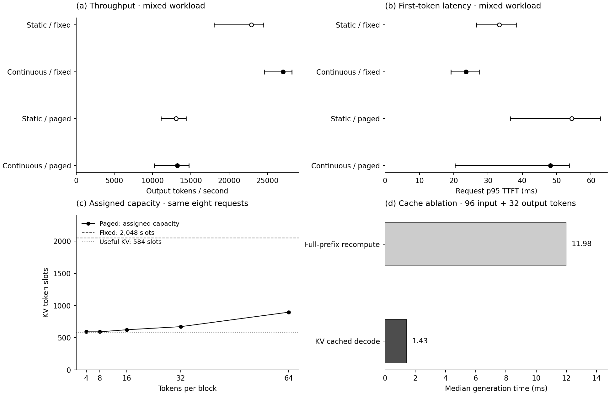
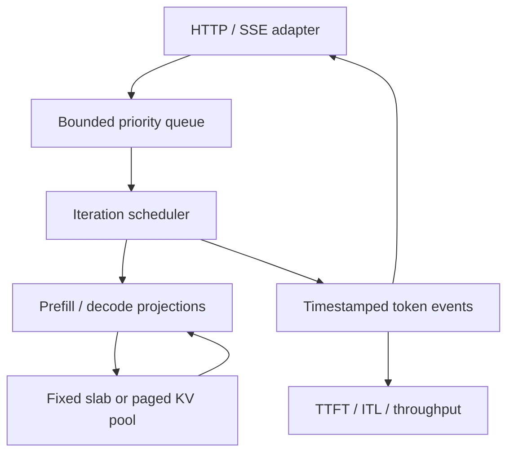

# KVServe

**Memory-Aware Inference Systems Lab**

A CPU reference implementation that makes LLM serving decisions inspectable: prefill and decode, incremental KV caching, block allocation, iteration scheduling, queue admission, and streamed completion events.

**Engineering question:** under a fixed KV budget, which changes improve request latency, which increase available concurrency, and which introduce enough implementation overhead to erase those gains?

This project uses a **49,408-parameter, untrained NumPy attention decoder**, so experiments isolate serving mechanics and can run on a laptop without model downloads. It does not evaluate language quality or claim production GPU performance. The HTTP layer uses FastAPI; the measured benchmark runs inside the process.

[Architecture](docs/architecture.md) · [Theory](docs/theory.md) · [Experiments](docs/benchmark.md) · [Design decisions](docs/decisions.md)

## Evidence at a glance

| Experiment | Verified reference result | Comparison and scope |
| --- | ---: | --- |
| KV caching | **8.39× faster** | 11.98 → 1.43 ms median; cached execution vs full-prefix causal recomputation; 96 input + 32 output tokens; seven measured repeats |
| Continuous scheduling | **18.1% higher throughput** | 22,883 → 27,022 output tokens/s; static vs continuous with the same fixed-cache layout; mixed-length CPU workload |
| First-token latency | **29.3% lower p95 TTFT** | Median of per-run p95 values; same scheduling comparison |
| Paged allocation | **69.5% less assigned KV capacity** | 2,048 → 624 token slots for the same eight request lengths; 16-token blocks; not a process-RAM reduction |
| Experimental coverage | **180 measured runs / 5,760 completions** | Three workload families × three workload seeds × four configurations × five repeats; matching outputs and released KV ownership in every run |

Paging reduced capacity waste but **was slower than contiguous attention in this Python implementation**. The result is useful: a memory-management improvement does not automatically provide a CPU throughput improvement. The [full matrix](docs/benchmark.md#scheduling-and-layout-matrix) reports every configuration.



Panels (a–b): mixed-length workload, medians across 15 runs; whiskers span the 10th–90th percentiles across runs. Panel (c): matched KV lengths, not an RSS measurement. Panel (d): a separate single-request compute experiment. [Vector figure](docs/assets/benchmark.svg) · [Claim ledger](results/reference/claims.json) · [Raw runs](results/reference/runs.jsonl) · [Environment and source hashes](results/reference/manifest.json)

## What was built



The decoder batches Q/K/V and output projections across active requests. Each request reads its own ragged attention history. The paged path computes online softmax directly over physical blocks; it never gathers an entire sequence into a temporary contiguous KV buffer.

The scheduler reserves a request's declared maximum KV requirement before admission, then allocates physical blocks as its sequence grows. This trades some admission flexibility for a clear guarantee: admitted requests can finish without growth-time KV exhaustion. The default FIFO admission order is stable within priority. An optional fit-first policy demonstrates the head-of-line blocking/fairness trade-off.

## Run it

Python 3.10+; the reference environment used Python 3.12. The core depends only on NumPy.

```bash
git clone https://github.com/sethu-ram-reddy/kvserve-inference-lab.git
cd kvserve-inference-lab
python -m venv .venv
source .venv/bin/activate
python -m pip install -e '.[server,dev]'

python scaffold.py
# Equivalent installed command:
kvserve demo
```

Generated bytes demonstrate execution of an untrained decoder. Meaningful chat responses require a trained model backend, which is outside this implementation.

## Serve requests

```bash
kvserve serve --port 8000

curl http://127.0.0.1:8000/health
curl http://127.0.0.1:8000/v1/completions \
  -H 'Content-Type: application/json' \
  -d '{"prompt":"Explain KV caching","max_tokens":16,"seed":7}'

curl -N http://127.0.0.1:8000/v1/completions \
  -H 'Content-Type: application/json' \
  -d '{"prompt":"Explain KV caching","max_tokens":16,"stream":true}'
```

One shared worker advances all active requests. SSE emits observed token and finish events; a cancelled stream releases its cache. `/metrics` exposes queue, reservation, allocation and completion counters. `/docs` contains the API schema. The local demo binds to `127.0.0.1` and has no authentication layer. The completion endpoint uses a small project-specific schema; it is not a complete OpenAI API implementation. See [HTTP semantics](docs/architecture.md#http-and-streaming).

## Reproduce the results

```bash
OPENBLAS_NUM_THREADS=1 OMP_NUM_THREADS=1 MKL_NUM_THREADS=1 \
  python -m benchmarks.run --output .runs/reproduced

python scripts/report.py --results .runs/reproduced --assets .runs/figures
python -m unittest discover -s tests -v
python scripts/smoke_http.py
```

The reference grid takes roughly tens of seconds on this host. CPU timings depend on hardware, NumPy/BLAS, system load and runtime versions. Each mode gets a discarded warm-up; execution order rotates across repeats and workload seeds. Output budgets disable early EOS in benchmarks. HTTP transport and model/pool construction are outside the timing scope. [Protocol and formulas](docs/benchmark.md)

## Where to read the implementation

| File | Read it to understand |
| --- | --- |
| [kvserve/model.py](kvserve/model.py) | What prefill computes; how cached decode differs from full-prefix recomputation |
| [kvserve/cache.py](kvserve/cache.py) | Block tables, atomic allocation, tail waste and online softmax |
| [kvserve/engine.py](kvserve/engine.py) | Admission reservations, static waves, continuous refill and token lifetimes |
| [kvserve/api.py](kvserve/api.py) | Shared worker, bounded queues, streaming and cancellation |
| [kvserve/metrics.py](kvserve/metrics.py) | Metrics derived from observed event timestamps |
| [benchmarks/run.py](benchmarks/run.py) | Paired workloads, 2×2 ablation, cache and block-size studies |
| [tests/](tests/) | Numerical equivalence, ownership, failure paths and HTTP behavior |

## Project context and provenance

Developed as an inference-systems project for **ChIEAC — Chicago Education Advocacy Cooperative**. It began with the 51-step Deep-ML *Build a Mini LLM Inference Server* exercise. The original solutions are preserved in [archive/](archive/); the maintained implementation adds a coherent engine, direct blockwise attention, an actual HTTP adapter, correctness checks and reproducible experiments. [What changed and why](docs/provenance.md)

The mechanisms are established systems techniques, inspired by [Orca](https://www.usenix.org/conference/osdi22/presentation/yu) and [PagedAttention](https://arxiv.org/abs/2309.06180). This project's contribution is their inspectable implementation, controlled evaluation and explicit failure handling at a small CPU scale. It makes no claim to invent continuous batching or paging.

[Model and system scope](docs/model-card.md) · [Results and evidence](results/reference/claims.json) · [Contributing](CONTRIBUTING.md)
