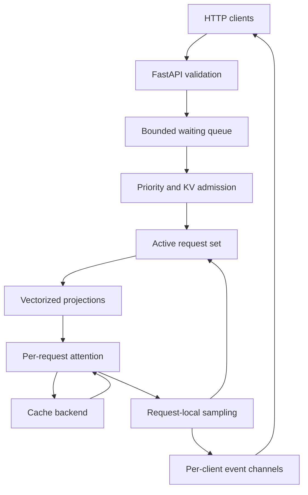
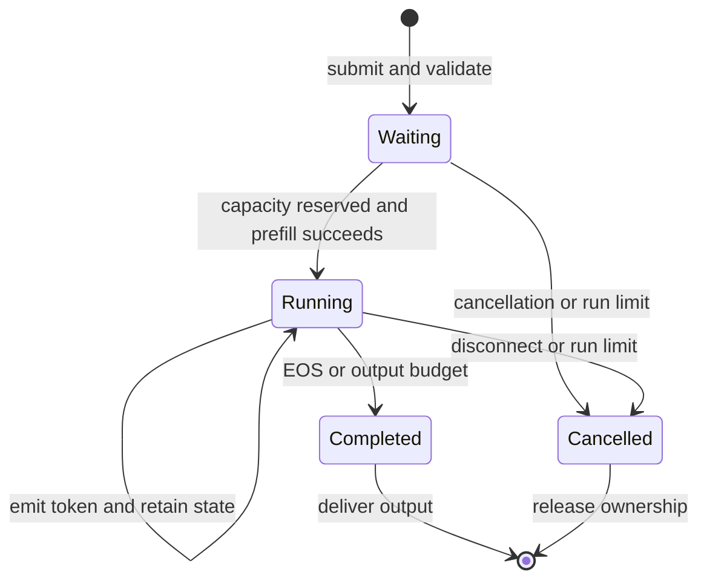
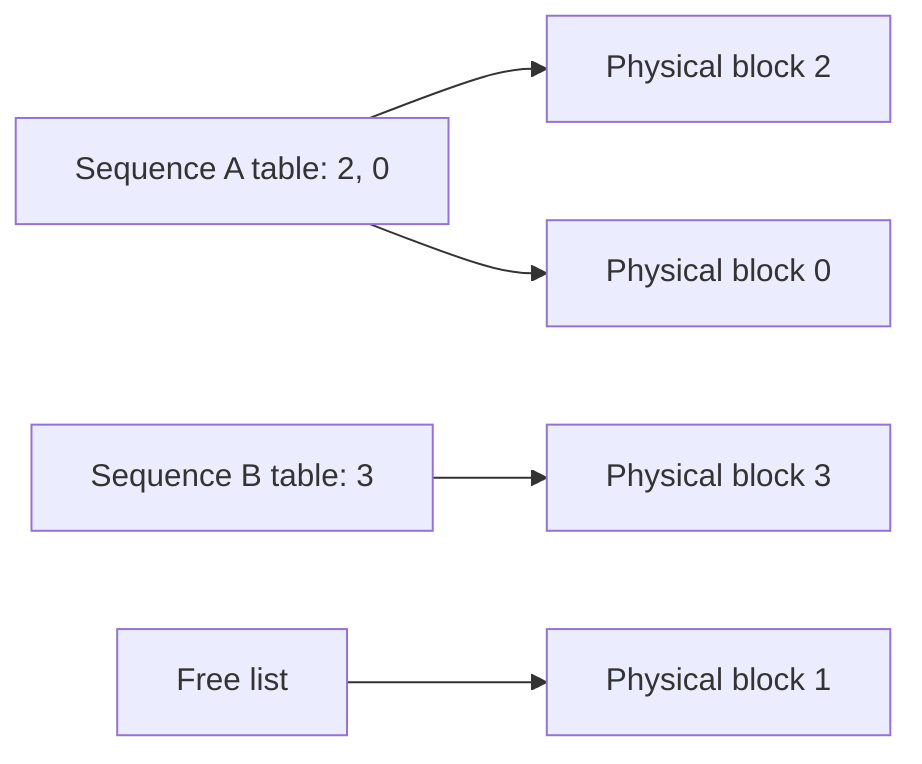

# Architecture and execution contracts

KVServe separates the model's computation, the cache's ownership, the scheduler's policy and the HTTP adapter's delivery. Changing one layer should not silently change another layer's semantics.

## Components

| Component | Owns | Does not own |
| --- | --- | --- |
| `AttentionDecoder` | Weight arrays, positional table, projections, logits | Request priority, arrival order, cache allocation policy |
| `ContiguousCache` / `PagedCache` | K/V rows, sequence lengths, physical storage | Token selection and completion budgets |
| `Engine` | Request-local RNGs, waiting/running state, reservations, events | HTTP connections or language quality |
| FastAPI adapter | Client channels, shared worker, response encoding, disconnect cleanup | A separate model instance per request |
| Benchmark harness | Workloads, paired policies, raw evidence, timing scope | Synthetic latency reconstruction |

The loop back to the active set happens only for requests needing another output. Finished requests release ownership immediately. A static policy nevertheless waits for the remaining members of its current wave before admitting new requests.

## Request lifecycle

A zero-output request completes without prefill. A request too large for the model context or an empty KV pool fails validation. It never enters a permanently blocked waiting state.

The engine keeps completed records for callers that invoke `run()`. The HTTP adapter removes completed records after delivery, disables persistent event tracing, and bounds the number of outstanding client channels. The benchmark enables tracing deliberately and saves it as an experiment artifact.

## One scheduler iteration

1. If continuous scheduling is enabled, or a static wave has drained, scan eligible waiting requests in `(priority, arrival order)` order.
2. Check the declared maximum KV reservation. Admit only requests that fit both the sequence-count cap and the remaining reserved capacity.
3. Prefill newly admitted prompts. Keep the logits for their first output; do not decode the prompt's final token again.
4. Batch projections for requests that already emitted a token and need a next one. Each attention read uses that request's cache.
5. Select one token per running request using its own RNG. Stamp the event at emission.
6. Retire completed requests, free their physical cache ownership and subtract their reservation.

Prefill is serialized across admissions and is not chunked. A long prefill can therefore delay active decode work; this is a documented limitation, not hidden behind the continuous-scheduling label.

## Cache ownership

Logical block order comes from a sequence's table, not the numeric order of physical blocks. A physical block has exactly one owner or is free. Prefix sharing and copy-on-write are not implemented.

`PagedCache.append` computes the full number of additional blocks before mutating ownership. If capacity is insufficient, it raises `CacheFull` with the tables, lengths and free list unchanged. Releasing a sequence is idempotent. Reused blocks are read only up to the new owner's valid length, so stale unused tail rows cannot affect attention.

`check()` verifies that all physical block IDs appear exactly once across ownership tables and the free list. It also verifies that table lengths match sequence lengths. The test suite covers partial pages, boundary crossings, insufficient capacity, reuse and repeated release.

## Assigned, useful and reserved capacity

These counters answer different questions:

- **Useful slots:** K/V rows containing valid sequence history.
- **Assigned slots:** rows belonging to the physical blocks or slabs currently owned by requests.
- **Reserved slots:** capacity promised for each admitted request's maximum remaining lifetime.
- **Pool slots:** the configured budget against which reservations are checked.

For pages, useful ≤ assigned ≤ reserved ≤ pool. For fixed slabs, assigned = reserved while a request is active. A request can finish at EOS and release the remainder of its promise. The reference performance grid disables early EOS to measure comparable output budgets.

The paged arrays preallocate `pool_slots × width × 2 × 4` bytes. Ownership counters do not describe total process memory, temporary arrays, weights or Python objects.

## HTTP and streaming

Start with `kvserve serve`. There is one model and one scheduler worker per application process. Concurrent HTTP handlers submit to the same engine. Running multiple Uvicorn workers creates independent model/pool instances; this project does not coordinate them.

| Endpoint | Behavior |
| --- | --- |
| `GET /health` | Readiness and explicit untrained-model flag |
| `GET /metrics` | Accepted, finished, cancelled and failed counts; active/waiting requests; KV counters |
| `POST /v1/completions` | Completion JSON or SSE, selected by `stream` |
| `GET /docs` | Generated request/response documentation |

For a completion request, `prompt` is UTF-8 encoded with one BOS token. `max_tokens` is the output budget, and context accounting includes input bytes, not Python character count. `temperature=0` means greedy decoding. Lower `priority` values are admitted first; equal priorities preserve arrival order. Running requests are not preempted by a later high-priority request.

SSE token events contain `request_id`, `tick`, `time_s`, `token_id` and a decoded text fragment. A finish event includes `finish_reason`; the final record is `data: [DONE]`. An incremental UTF-8 decoder prevents the streaming adapter from incorrectly treating a multibyte character as independently decodable bytes. Special tokens have no byte representation. `output_ids` remains the canonical output for numerical comparisons.

The adapter's channels are bounded by each request's output limit plus terminal events. A slow client therefore retains at most one bounded request output, rather than growing an unrestricted stream buffer. This is bounded buffering, not transport-aware token-level backpressure into the engine. The total outstanding-client count is bounded separately.

Disconnect cleanup cancels a queued/running request, releases its reservation and pages, removes its channel, and discards any completed record. Worker failures cancel affected requests and wake their clients. The engine is cooperatively driven on the event loop; a CPU-heavy step can temporarily block other handlers. A production integration would isolate the compute worker and explicitly budget prefill time.

## Extension boundaries

A trained backend would need to retain the same scheduler contracts while replacing single-layer NumPy operations with multilayer model execution. Additional work would include tokenizer/model compatibility, per-layer KV layouts, grouped-query attention, GPU synchronization-aware timing, fused attention kernels, actual client-side load generation, and quality validation. Merely swapping in a checkpoint does not establish any of those guarantees.
