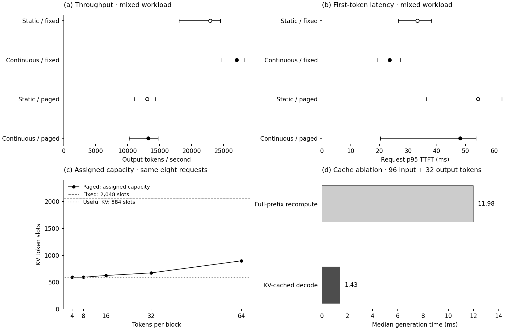
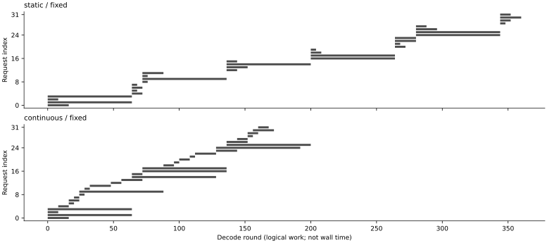

# Experimental protocol and results

The evidence in `results/reference/` comes from actual CPU execution. The central experiment separates scheduling from KV layout; two smaller experiments isolate caching and assigned capacity.

## Questions and controls

| Question | Changed factor | Held constant |
| --- | --- | --- |
| Does continuous refill help mixed-length requests? | Static vs continuous scheduling | Cache layout, model, requests, output budgets, pool budget, sampling |
| Does paging translate to higher CPU throughput? | Fixed vs paged cache | Scheduler, model, requests, pool budget |
| How much assigned capacity does block rounding consume? | Block size | Same eight final KV lengths and model width |
| What does incremental KV reuse save? | Cached vs full-prefix recomputation | One prompt, model, greedy output and generation budget |

## Reference setup

- Model: untrained single-head attention decoder; 49,408 parameters; width 64; max context 256; float32 weights and KV rows; fixed model seed 7.
- Main grid: 32 requests per burst, pool budget 1,024 KV token slots, at most 16 running requests, 16-token pages, stable priority/FIFO admission.
- Greedy sampling; EOS disabled explicitly so every request performs its declared output budget. This avoids policy-dependent early termination from changing work volume.
- Three workload seeds, 7/19/42; five measured repeats for each workload/configuration/seed combination.
- Four configurations: static/fixed, static/paged, continuous/fixed, continuous/paged.
- One discarded warm-up per workload seed and configuration. Mode order rotates across repeats and workload seeds.
- BLAS/OpenMP thread environment set to one before Python starts. CPU, Python, package versions and source SHA-256 hashes are in [manifest.json](../results/reference/manifest.json).

This produces **180 measured runs and 5,760 completed request executions**. They are repeated executions of nine workload instances, not 5,760 independent semantic prompts or independent statistical samples. Identical workloads are paired across configurations. The model is not retrained between seeds; these are workload seeds.

The main loop measures from before submission through completion. Model/pool construction, warm-up, JSON writing and chart generation are outside its measured interval. Runtime event instrumentation is inside. There is no HTTP/network load in these numbers.

## Workloads

All requests are submitted as one burst. This controls queue contention but is not a Poisson arrival process or a sustained request-rate experiment.

| Family | Prompt tokens | Output budget | Purpose |
| --- | --- | --- | --- |
| Uniform | 32 | 24 | Negative control: equal-length requests give little scheduling-refill opportunity |
| Mixed | Seeded choice of 12/24/48/80 | Seeded choice of 4/8/16/64 | Heterogeneous prompt and response lengths |
| Long tail | Seeded choice of 16/32/64 | Every eighth request: 96; others: 8 | Long-running members hold up static waves |

The prompt IDs are seeded synthetic bytes plus BOS. This is a systems workload, not a text dataset or a quality benchmark. Checked-in workloads make exact request lengths and token IDs inspectable.

## Scheduling and layout matrix

The table reports medians across 15 runs per cell: three workload seeds × five repeats. TTFT columns contain the median of each run's request-level p95, not a pooled percentile over all requests. Decode rounds and mean active requests are also medians across runs.

| Workload | Scheduling / cache | Output tokens/s | p95 TTFT (ms) | Decode rounds | Mean active |
| --- | --- | ---: | ---: | ---: | ---: |
| uniform | static / fixed | 29,686 | 22.32 | 192 | 4.00 |
| uniform | static / paged | 19,254 | 20.87 | 48 | 16.00 |
| uniform | continuous / fixed | 29,437 | 22.88 | 192 | 4.00 |
| uniform | continuous / paged | 19,051 | 20.93 | 48 | 16.00 |
| mixed | static / fixed | 22,883 | 33.29 | 408 | 1.85 |
| mixed | static / paged | 13,036 | 54.37 | 192 | 4.48 |
| mixed | continuous / fixed | 27,022 | 23.55 | 204 | 3.64 |
| mixed | continuous / paged | 13,232 | 48.14 | 96 | 7.21 |
| long tail | static / fixed | 21,269 | 27.06 | 416 | 1.46 |
| long tail | static / paged | 12,182 | 31.03 | 200 | 3.04 |
| long tail | continuous / fixed | 25,919 | 18.24 | 192 | 3.17 |
| long tail | continuous / paged | 12,190 | 13.34 | 104 | 5.85 |

For the mixed workload with fixed slabs, continuous scheduling raises median output throughput **18.1%** and lowers the median of per-run p95 TTFT values **29.3%**. The uniform workload offers little benefit because equal output lengths cause the cohort to finish together.

Under the same pool budget, fixed slabs admit at most four full-context requests, while pages can admit more short requests. Paged configurations therefore improve concurrency and reduce required decode rounds. However, their per-block Python/NumPy work is expensive enough that the measured CPU throughput is lower. The experiment supports a capacity result and a scheduling result, not a universal paged-attention speed claim.



Figure whiskers in panels (a–b) show the 10th–90th percentiles across the 15 run values. They are not confidence intervals. Repeats share one host and a small set of workload instances; these results are descriptive rather than a significance test.

### Inspect the actual schedule



This figure uses real admission/finish ticks from the mixed workload, seed 7, repeat 0. A horizontal segment shows one request's active lifetime. The x-axis is logical decode rounds, not milliseconds. Traces include the corresponding real event timestamps in [traces/](../results/reference/traces/).

## Assigned-capacity study

Take the first eight requests from mixed workload seed 7 and populate each cache to `prompt_length + output_budget - 1`. These are declared full-budget lengths, not an early-EOS measurement. There are **584 useful KV rows**. The fixed layout assigns **2,048** slots (eight × 256).

| Block size | Paged assigned slots | Tail slots | Reduction vs fixed slabs |
| ---: | ---: | ---: | ---: |
| 4 | 592 | 8 | 71.09% |
| 8 | 592 | 8 | 71.09% |
| 16 | 624 | 40 | **69.53%** |
| 32 | 672 | 88 | 67.19% |
| 64 | 896 | 312 | 56.25% |

At width 64 with float32 K/V, each slot corresponds to 512 bytes of KV capacity. The 16-token layout assigns 312 KiB, compared with 1,024 KiB of fixed slabs at the same request lengths. The paged pool still preallocates 1 MiB in this snapshot experiment. This does **not** measure a 69.5% reduction in process RSS, GPU memory, or total resident array storage.

The capacity snapshot uses a 2,048-slot pool to hold the same eight requests in both layouts. It is separate from the 1,024-slot main grid; combining those settings would mix experiments. The block-size sweep measures capacity rounding only. It does not establish a fastest block size.

## Cache compute study

A single 96-token input generates 32 outputs. Full-prefix causal recomputation and incremental cached execution produce the same greedy output IDs. Seven measured repetitions follow a discarded warm-up.

| Path | Median time |
| --- | ---: |
| Full-prefix causal recomputation | 11.98 ms |
| Incremental KV-cached execution | 1.43 ms |

The ratio of medians is **8.39×**. This is a CPU microbenchmark against this repository's explicit full-prefix reference. That reference computes the full causal attention matrix for each growing prefix, while the single-layer cached implementation uses only the query needed for the next output. It is not a speedup over vLLM, Hugging Face generation, a trained LLM, or an optimized uncached last-query implementation. Allocation of the fixed cache happens before this compute-only timer. The microbenchmark always executes recomputation first, so its seven paired repeats do not fully eliminate execution-order bias.

## Event accounting

`submit`, `admit`, `token` and `finish` events carry `perf_counter` timestamps relative to the engine's origin. The metrics implementation calculates:

- TTFT: first token minus request submission; includes queueing and prefill.
- Queue wait: admission-start event minus submission. The separate `prefill_end` event marks prompt computation completion.
- ITL: gaps between consecutive token events within each request. Percentiles pool those within-request gaps for one run.
- End-to-end latency: finish minus submission.
- Throughput: emitted output token count divided by elapsed wall time for the run.

A zero-token request has no TTFT/ITL observation. A one-token request has no ITL observation. Missing observations are represented by `null`, not fabricated zero latencies. The summarizer rejects a benchmark with unfinished submitted requests.

## Evidence files

| File | Purpose |
| --- | --- |
| `runs.jsonl` | Every measured run, output digest, metric values and ownership-release check |
| `summary.json` / `summary.csv` | Recomputed per-cell medians and throughput quantiles |
| `workloads/` | All nine prompt-ID/budget instances |
| `outputs/` | Canonical generated IDs for all nine instances |
| `traces/` | Four representative policy/layout traces with observed events and occupancy |
| `memory.json` | Matched-length block-size counters |
| `cache.json` | Every measured cache microbenchmark pair |
| `claims.json` | Headline values generated from evidence by `scripts/report.py` |
| `manifest.json` | Model/workload settings, environment and source checksums |

Sixteen regression and evidence tests recompute metrics from representative traces, validate output digests against canonical outputs, verify grid completeness and check model/cache numerical equivalence. A separate loopback HTTP smoke test completed eight concurrent 24-token requests and observed cancellation cleanup after an early stream close; its counters are in `http-smoke.json`. It is an integration check, not a transport benchmark.

## Reproduce and interpret

```bash
python -m pip install -e '.[dev,server]'
OPENBLAS_NUM_THREADS=1 OMP_NUM_THREADS=1 MKL_NUM_THREADS=1 \
  python -m benchmarks.run --output .runs/reproduced
python scripts/report.py --results .runs/reproduced --assets .runs/figures
python -m unittest discover -s tests -v
python scripts/smoke_http.py
```

The maintained code uses no downloaded models or datasets. Regenerated timing values will vary with hardware, BLAS and shared-host noise. Workloads, output equivalence, ownership invariants and declared capacity calculations are the more portable reproduction targets. Timing ratios must be remeasured on the target machine.

Next useful experiments are client-observed SSE latency under offered load, chunked prefill, explicit SLO attainment, sustained arrival fairness, and a trained multilayer GPU backend. These are future work, not features or measurements implied by this release.
