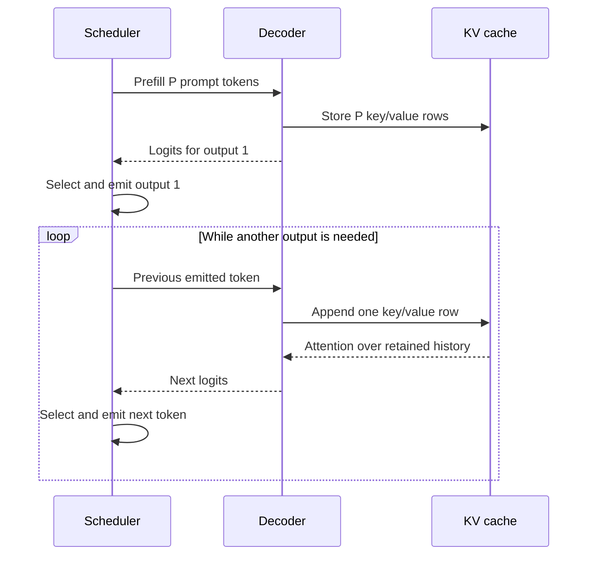

# The mechanics behind KVServe

Read this alongside `kvserve/model.py`, `cache.py` and `engine.py`. The goal is to connect each systems decision to the computation it changes.

## 1. Why inference is a scheduling problem

Autoregressive generation repeatedly predicts a token conditioned on the prefix. For a request with prompt $x_{1:P}$ and output $y_{1:G}$,

```math
p(y_{1:G}\mid x)=\prod_{t=1}^{G}p(y_t\mid x,y_1,\ldots,y_{t-1}).
```

A request cannot know its next input token until it selects its current output token. Requests also have different prompt lengths and output budgets. A batch that waits for its longest member leaves admission slots idle after shorter members finish. A server must decide which requests to admit, how much KV capacity to promise, and when to reuse released resources.

There are two distinct phases:

- **Prefill:** process the known prompt and retain its key/value representations. Its final logit vector predicts output token 1.
- **Decode:** feed the previously emitted token into the model, append its K/V row, and predict the following output token.

For $G$ emitted tokens, only $G-1$ generated tokens must be fed back. The final emitted token does not need another forward pass. KVServe therefore requires capacity for $P+\max(G-1,0)$ positions. An off-by-one here can duplicate the prompt's last token, overflow a full context, or compare different computations across implementations.



## 2. The attention decoder

The project uses byte tokens plus BOS/EOS: 258 possible IDs. An input embedding receives sinusoidal positional information before its Q/K/V projections:

```math
X=E[\text{ids}]+\text{Position}(0,\ldots,T-1),\quad Q=XW_Q,\ K=XW_K,\ V=XW_V.
```

For head width $d$, causal attention is

```math
\text{Attention}(Q,K,V)=\text{softmax}\left(\frac{QK^\top}{\sqrt d}+M\right)V,
```

where future positions receive $-\infty$ in $M$. An output projection followed by the vocabulary head produces token logits.

KVServe has one attention head and one attention block. It omits MLPs, residual connections, normalization and a layer stack. Its weights are seeded random float32 arrays, not trained parameters. This makes the attention and serving paths easy to inspect, while deliberately limiting conclusions about realistic language-model inference.

For width 64, trainable-shaped weight arrays contain

```math
2Vd+4d^2=2(258)(64)+4(64)^2=49{,}408
```

parameters. The deterministic positional table is not counted as model weights.

In a single attention block, only the final prompt query is needed to predict the first output: K/V at earlier positions depend directly on their own input embeddings. `prefill` projects all prompt inputs but evaluates only that final query. A multilayer Transformer must compute intermediate hidden states for the preceding positions; this shortcut cannot simply be transferred to it. `uncached_logits` implements the full causal matrix as a correctness reference.

## 3. What KV caching saves

At decode step $t$, old tokens' key and value projections are unchanged. Recomputing the prefix would repeatedly calculate them. A KV cache saves those projections once and appends just one new row per decode input.

For one single-head layer with float32 cache values, the useful KV bytes for a length-$T$ sequence are

```math
M_{KV}=2Td\cdot4.
```

The 2 counts keys and values. A general multilayer model instead uses

```math
M_{KV}=2LTn_{KV}d_{head}b,
```

where $L$ is the number of layers, $n_{KV}$ is the number of KV heads, and $b$ is bytes per scalar. Grouped-query attention can make $n_{KV}$ smaller than the number of query heads. Model weight precision and KV precision are separate choices.

Caching does not make attention history disappear. The new query still reads the retained K/V rows. In real GPU serving, decode can be constrained by memory movement; this project demonstrates the mechanics without measuring GPU bandwidth.

The compute microbenchmark uses 96 prompt tokens and 32 outputs. Full-prefix recomputation projects $\sum_{i=0}^{31}(96+i)=3568$ token rows; incremental execution projects $96+31=127$. That is a count of projected input rows, not a FLOP ratio or a promised latency ratio. The measured latency comparison is reported separately.

## 4. Fixed slabs versus pages

A fixed cache allocates two contiguous $[T_{max},d]$ arrays per admitted sequence. This makes reads simple, but a short sequence occupies the same assigned capacity as a long one.

A paged cache owns a pool of $B$-token blocks. A sequence's logical position $i$ maps through its private block table:

```math
\text{logical block}=\lfloor i/B\rfloor,\quad \text{offset}=i\bmod B.
```

The table supplies a physical block index. Different sequences may own interleaved physical blocks; neither sequence needs a contiguous physical range.

For lengths $T_1,\ldots,T_N$, assigned capacity is

```math
C_{fixed}=NT_{max},\qquad C_{paged}=\sum_{j=1}^{N}B\left\lceil T_j/B\right\rceil.
```

Only the final block of each sequence can have unused assigned slots, giving a tail-waste bound of fewer than $NB$ slots. Smaller blocks reduce that rounding waste but increase table and traversal overhead. The [block-size experiment](benchmark.md#assigned-capacity-study) measures the capacity side of this trade-off.

**Assigned capacity and resident RAM are different.** `PagedCache` preallocates the entire pool. Giving a block to a request changes ownership; it does not allocate a new process-memory region. The 69.5% result compares sequence-assigned slots against fixed slabs at matching lengths. It is not an RSS, GPU-memory or hardware-allocation measurement.

## 5. Attention directly over blocks

The legacy implementation gathered all the pages into contiguous K/V arrays before attention. KVServe instead updates the softmax normalization as it reads each physical block.

Maintain a running maximum $m$, denominator $l$, and weighted numerator $o$. For block logits $s$ and values $V_b$,

```math
m'=\max(m,\max(s)),\quad \alpha=e^{m-m'},\quad w=e^{s-m'},
```

```math
l'=\alpha l+\sum_iw_i,\qquad o'=\alpha o+wV_b.
```

The final context is $o/l$. This is mathematically the same normalized weighted sum as concatenating the blocks and applying softmax once, up to floating-point rounding. Float64 accumulation improves numerical stability in this CPU reference; cache rows remain float32.

This is an online-softmax reference algorithm, not a fused PagedAttention CUDA kernel. Python loops and small NumPy operations impose overhead. The test suite compares blockwise contexts against contiguous attention across several page boundaries and checks cached logits against full causal recomputation.

## 6. Iteration scheduling and batching

**Static waves:** admit a cohort, advance its active members, and wait until every member finishes before admitting a new cohort. Finished members stop consuming compute and release KV ownership, but their scheduling slots cannot be refilled until the wave ends. This is a reasonably efficient static baseline, not one that deliberately recomputes padding for finished requests.

**Continuous scheduling:** at every round boundary, admit waiting requests into available slots and reserved KV capacity. Short requests can be replaced while longer requests continue.

Both modes use the same attention decoder, output budgets and request seeds. Q/K/V and output projections are vectorized across active decode inputs. Ragged attention remains per request. This is selective CPU batching, not a single fused GPU operation for the whole batch.

A useful invariant is

```math
\sum_{r\in\text{running}}\text{reserved}(r)\le C_{pool}.
```

For fixed slabs, reservation is $T_{max}$. For pages, it is the rounded declared maximum length. Actual page assignment grows with the cache. A request that cannot fit an empty pool is rejected rather than left waiting forever.

Conservative reservation avoids growth-time out-of-memory failures, but it can under-admit when requests stop early. Serving systems can instead overcommit and use preemption, recomputation or swapping. KVServe chooses the simpler guarantee and documents this cost; it does not implement those mechanisms.

## 7. Why randomness belongs to the request

A global RNG would hand each request different random draws when the scheduler changes execution order. An apparent output mismatch could then be a sampling-order artifact rather than a model/cache bug.

Each request owns its own generator. Temperature scales logits; top-k keeps a fixed number of candidates; top-p retains enough probability mass to cross the nucleus threshold. The token crossing that threshold remains eligible. A temperature of zero selects the argmax.

With identical request seeds, policy changes should preserve generated token IDs. Tests cover greedy and stochastic cases. The 180-run performance grid uses greedy sampling to keep output work fixed and directly comparable.

## 8. Latency is an observed timeline

For request $r$, let $s_r$ be submission, $a_r$ admission, $f_r$ its first emitted token, and $t_{r,i}$ token timestamps.

```math
TTFT_r=f_r-s_r,\quad W_r=a_r-s_r,\quad ITL_{r,i}=t_{r,i+1}-t_{r,i}.
```

Output throughput divides emitted token count by measured elapsed wall time. End-to-end latency runs from submission to finish. TTFT includes queueing and prefill; it is not just the decode kernel duration.

Events are stamped with `perf_counter` when the scheduler observes them. The in-process emission point is distinct from the time a client receives an SSE byte over a network. Reconstructing timestamps by distributing chunks across elapsed time cannot establish TTFT or ITL; this project removed that behavior from the maintained path.

## Read the research

- [Orca, OSDI 2022](https://www.usenix.org/conference/osdi22/presentation/yu): iteration-level scheduling and selective batching.
- [PagedAttention, SOSP 2023](https://arxiv.org/abs/2309.06180): block-based KV management and a GPU serving system.
- [vLLM authors' explanation](https://vllm.ai/blog/2023-06-20-vllm): cache growth, memory waste and the motivation for paging.

These sources explain the established mechanisms. Their reported production-system gains are not KVServe's benchmark results.
